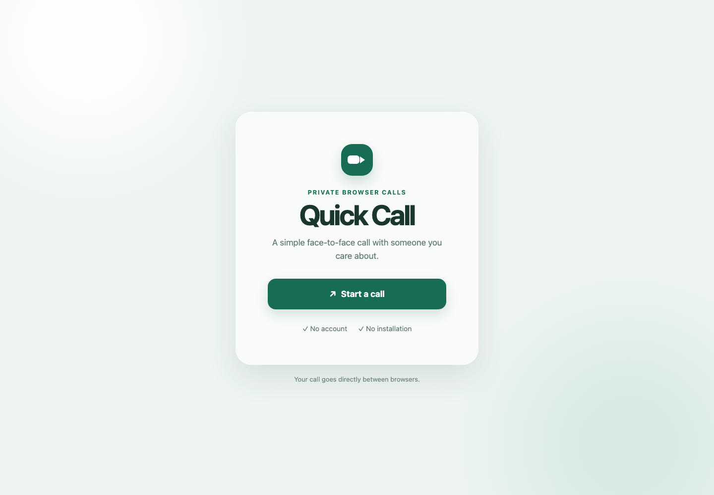

# Quick Call

A static, serverless, two-person WebRTC video call built with React, TypeScript, and Vite.



Start a call, exchange invitation and response links, and talk directly between browsers. No account or installation is required.

This is a Phase 1 prototype: one-to-one calls with camera and microphone controls, manual signaling, and connection diagnostics. Direct connections are best effort; some mobile and corporate networks cannot connect without a relay.

## Run locally

```bash
npm install
npm run dev
```

`localhost` may use camera and microphone without HTTPS. Physical phones require the app to be served over HTTPS.

## Manual call flow

1. Browser A starts a call and creates an invitation.
2. Browser B opens the invitation, joins, and sends the generated response URL back.
3. Browser A opens the response URL on the same device. `BroadcastChannel` delivers it to the original call tab.
4. If automatic delivery fails, paste the response URL into **Connection problem? Import response** in Browser A's call tab.
5. Keep both original call tabs open. Media and the control channel connect directly between them.

There is intentionally no backend, room server, database, WebSocket signaling, TURN server, or media server. Calls are direct P2P and therefore may not connect through restrictive carrier or corporate networks.

## Checks

```bash
npm test
npm run typecheck
npm run build
```

## Cloudflare Workers deployment

The app is deployed as static assets only; there is no backend Worker entry point.

```bash
npm run preview
npm run deploy
```

Wrangler publishes `./dist` and serves `index.html` as the fallback for SPA routes.

## Connection diagnostics

During a call, expand **Connection diagnostics** below the link-sharing controls. It shows connection and ICE state, the control channel, candidate types, IPv4/IPv6 availability, and the selected route.

Start from `http://localhost:5173/?debug=1` (or add `?debug=1` to your deployed URL) to enable periodic statistics, including bitrates, RTT, packet loss, frame counts, and outgoing resolution. Development builds enable these statistics automatically. The debug flag is preserved in invitation and response links.
